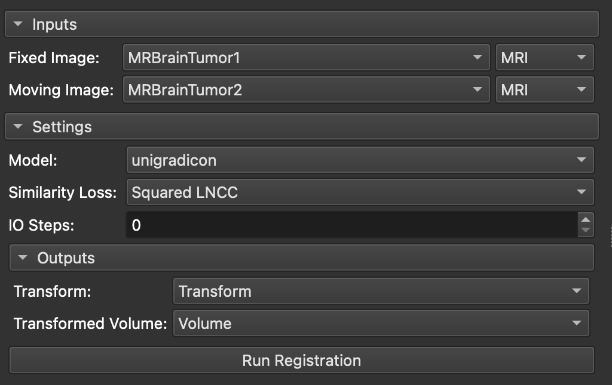

# SlicerUniGradICON

[](https://arxiv.org/abs/2403.05780) [](https://arxiv.org/abs/2408.00221) 

This is the official Slicer Extension for `uniGradICON`: A Foundation Model for Medical Image Registration, and `multiGradICON`: A Foundation Model for Multimodal Medical Image Registration. The extension provides a Slicer interface for the models, allowing users to perform image registration tasks using the models. The official repository for the models can be found [here](https://github.com/uncbiag/uniGradICON).

**uniGradICON: A Foundation Model for Medical Image Registration**  
Tian, Lin and Greer, Hastings and Kwitt, Roland and Vialard, Francois-Xavier and Estepar, Raul San Jose and Bouix, Sylvain and Rushmore, Richard and Niethammer, Marc  
_MICCAI 2024_ https://arxiv.org/abs/2403.05780  

**multiGradICON: A Foundation Model for Multimodal Medical Image Registration**  
Demir, Basar and Tian, Lin and Greer, Thomas Hastings and Kwitt, Roland and Vialard, Francois-Xavier and Estepar, Raul San Jose and Bouix, Sylvain and Rushmore, Richard Jarrett and Ebrahim, Ebrahim and Niethammer, Marc  
_MICCAI Workshop on Biomedical Image Registration (WBIR) 2024_ https://arxiv.org/abs/2408.00221  

Please (currently) cite as:
```
@article{tian2024unigradicon,
  title={uniGradICON: A Foundation Model for Medical Image Registration},
  author={Tian, Lin and Greer, Hastings and Kwitt, Roland and Vialard, Francois-Xavier and Estepar, Raul San Jose and Bouix, Sylvain and Rushmore, Richard and Niethammer, Marc},
  journal={arXiv preprint arXiv:2403.05780},
  year={2024}
}
```
```
@article{demir2024multigradicon,
  title={multiGradICON: A Foundation Model for Multimodal Medical Image Registration},
  author={Demir, Basar and Tian, Lin and Greer, Thomas Hastings and Kwitt, Roland and Vialard, Francois-Xavier and Estepar, Raul San Jose and Bouix, Sylvain and Rushmore, Richard Jarrett and Ebrahim, Ebrahim and Niethammer, Marc},
  journal={arXiv preprint arXiv:2408.00221},
  year={2024}
}
```

## Installation

For local registration or hosting a registration server from Slicer, install the **PyTorch** extension from the Extensions Manager and restart Slicer. A Slicer client that uses remote processing does not need PyTorch, `icon_registration`, or model weights installed locally.

To install the uniGradICON extension, clone this repository using the following command:
```
git clone https://github.com/uncbiag/SlicerUniGradICON.git
```

Then, drag and drop the cloned repository folder into the Slicer window and click "OK" to install the extension. After the installation is done, the extension will appear under the Modules -> Registration menu.

## Local and remote processing

UniGradICON can register images directly in Slicer or send them to a registration server on another computer. Remote processing is useful when the GPU is on another machine or PyTorch cannot run in the client Slicer.

To connect to a running server, enable **Remote processing** under **Inputs**, enter its address (`hostname:8899`) and access token if required, then click **Connect**. Select one of the devices reported by the server and click **Run registration**. The images are uploaded to the server; the resulting transform is downloaded along with the transformed image if **Create transformed volume** is enabled. The server resamples that image using the same ITK code as local registration. The server token is stored in this computer's Slicer settings, not in the saved scene.

To host a server from a Slicer with a working local registration backend, expand **Local registration server**, choose a port and access token, then click **Start server**. The button changes to **Stop server** while it is running. Another Slicer can connect to the displayed address; for testing on the same computer, use `127.0.0.1:8899` (or your chosen port).

A server can also run without Slicer using Python, a compatible PyTorch installation, and the server dependencies. See the [registration server README](UniGradICON/UniGradICONServer/README.md) for installation, model weights, access tokens, SSH tunnels, firewall access, and jobs per GPU. Images are transferred to the server; use a trusted server and an SSH tunnel or HTTPS outside a trusted network.

## User Guide

<div style="text-align: center;">
    
</div>

1. Select the fixed and moving scalar images, and their modality (MRI or CT/CBCT). The extension preprocesses their intensities automatically. Linear parent transforms are included in the input world geometry. Harden nonlinear parent transforms in Slicer before registration; they are rejected rather than silently ignored.

2. The extension provides two models: `uniGradICON` and `multiGradICON`. Both models have the same interface and can be used to perform image registration tasks. The user can select the desired model from a drop-down menu.

3. Additionally, the user can specify the number of iterations for the instance optimization (IO steps) process. The default value is set to 0 iterations. However, we recommend using at least 50 iterations for more challenging registration tasks.

4. The user can also select the similarity loss function that will be used during the optimization process. The available similarity losses are:
    - Localized Normalized Cross-Correlation (LNCC)
    - Squared Localized Normalized Cross-Correlation (Squared LNCC)
    - Modality Independent Neighborhood Descriptor (MIND - SSC)
    
   For multimodal registration tasks, we recommend using the Squared LNCC or MIND - SSC similarity loss. Note that if IO steps are set to 0, the selected similarity loss function will not be applied.

5. The user can select the device that model will be run on. The available options are:
    - CPU
    - GPU (CUDA)
    
    If GPU is selected, the extension will use the GPU for the optimization process. Note that the GPU option is only available if the user has a CUDA-compatible GPU. Also, there are some limitations on the GPU memory usage. The peak memory usage of the model is as follows:

    - `w/o Instance Optimization`: 3364.0 MB
    - `w/ Instance Optimization using LNCC`: 11446.0 MB
    - `w/ Instance Optimization using Squared LNCC`: 11490.0 MB
    - `w/ Instance Optimization using MIND-SSC`: 14814.0 MB
  
    Please make sure that your GPU has enough memory to run the model. If the GPU memory is not sufficient, prefer using the CPU option.

6. Expand **Outputs** to select existing output nodes, or leave them unselected to create outputs automatically with names based on the moving and fixed images. **Create new outputs** preserves previous results. If a selected output already contains data, running offers **Create new outputs**, **Overwrite**, or **Cancel**. Clear **Create transformed volume** to request only the transform. Both returned results are validated before existing outputs are replaced, and old output parent transforms are cleared because registration results use world coordinates.

7. Click **Run registration**. The button changes to **Cancel** for both local and remote runs. Inputs, settings and output selectors are locked during the run, while image viewers remain usable. The status reports preparation, model loading, uploads, queue position, registration, resampling and result loading as applicable. IO steps show optimization progress and an estimated remaining time when available; stages without measurable progress, including 0-step inference, show an activity indicator. Cancellation changes the button to **Cancelling…** until the background task finishes. A remote transfer may need to finish before cancellation reaches the server; the server may complete its current step before stopping. Cancellation leaves output nodes unchanged.

8. Completion appears inline with the elapsed time. **Compare images** opens after a successful run with a transformed volume. Click **Compare result** for a 50% overlay of the registered volume on the fixed image; **Show original** switches back to the original moving image. Choose **Checkerboard** under **Mode** for alternating tiles. **Tiles per axis** controls their size: more tiles make smaller checks. The same result/original button works in both modes. Checkerboards run asynchronously, include linear parent transforms, and resample the second image onto the fixed grid. Temporary preview nodes are cleaned up and excluded from saved scenes; saved views reference real images while the live checkerboard is restored after saving. Changing inputs or the parameter set invalidates stale comparisons. Outputs are also available under **Data** for other comparisons.

Registration progress and status stay directly below **Run registration**, outside the collapsible settings. Comparison has its own status line, so switching views does not replace the completion message. **Local registration server** and **Log** are separate collapsible sections; the server log opens when hosting a server with **Log to GUI** enabled. Errors remain visible with recovery guidance, and the controls are restored for another run.

Local and remote registrations both create the optional transformed volume using the same **ITK linear resampling** code, with floating-point output on the fixed image's grid. For remote registration, this runs on the server and the resulting image is downloaded; the Slicer client does not need local ITK or PyTorch. With **Create transformed volume** cleared, only the transform is generated and downloaded. Existing parameter sets that requested only a transform keep that setting.

GPU registration uses deterministic cuDNN convolutions to reduce run-to-run variation. For repeatability comparisons, use **0 IO steps**: instance optimization includes random sampling and CUDA backward operations, so identical optimized results are not guaranteed. Results can also differ across hardware or PyTorch versions.

## Troubleshooting

Here are some common issues that may arise during the installation and use of the extension, along with their solutions:

- Local runs download missing model weights in the background. If backend Python packages are missing, first-use setup still asks before installing them and may take a few minutes. Remote-only clients do not need this local setup. Each interactive local run uses an isolated worker process, loading its model before inference; this lets cancellation stop even a 0-IO-step forward pass without blocking Slicer.

- The I/O process takes approximately one second per iteration on a GPU. Please be patient during the optimization process, particularly when using a CPU.
- If an error arises due to incompatibility between `setuptools` and `distutils`, update `setuptools` using the following command in the Slicer Python Console: `slicer.util.pip_install("setuptools -U")`

- **PyTorch/NumPy compatibility**: Some PyTorch builds cannot use the NumPy version bundled with Slicer, producing errors such as `_ARRAY_API not found` or `Numpy is not available`. When the panel detects this incompatibility, it reports the problem and selects remote processing. Connect to a registration server with a compatible backend; see the [server setup instructions](UniGradICON/UniGradICONServer/README.md).

## Acknowledgements
This implementation is based on the [SlicerANTs](https://github.com/netstim/SlicerANTs) and [SlicerSegmentWithSAM](https://github.com/mazurowski-lab/SlicerSegmentWithSAM) repositories. We thank the authors for their work.
